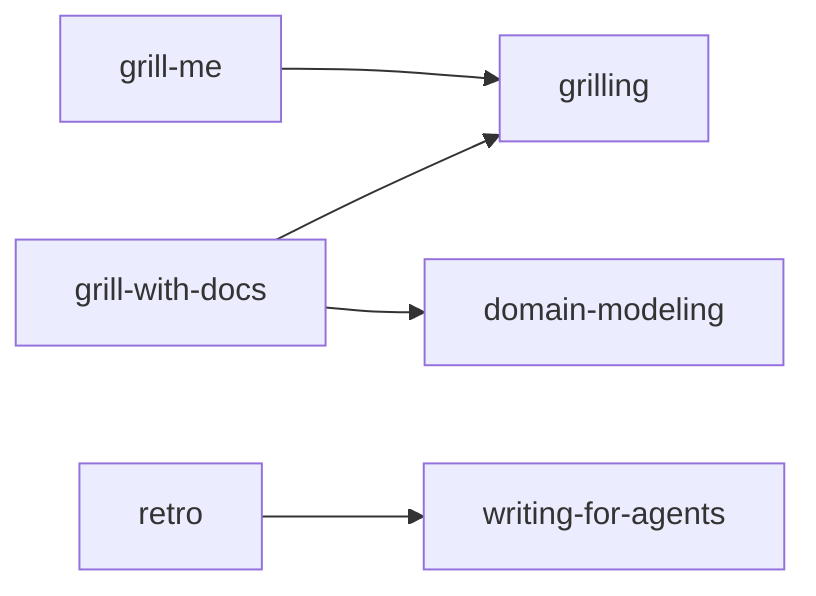

# mattpocock

按来源归组：收录 `mattpocock/skills` 里用得上的一组 skill，不按用途再分类。

这是本仓库唯一按来源划分的目录。原因是这些 skill 互相调用，拆散登记会让上下文不完整：`grilling` 单独装能跑，但常用入口是 `grill-me` / `grill-with-docs`，而 `grill-with-docs` 又依赖 `domain-modeling`，少了这些，「拷问 → 产出文档 → 收敛术语」这条链路就断了。

## 这组 skill 怎么用

- **`grilling`**：拷问本体。把想法、计划或决定当设计树，一轮轮追问到没有默认假设。也可以直接用它，不必经过包装。
- **`grill-me`**：入口包装，对当前方案做不留情面的拷问。
- **`grill-with-docs`**：拷问的同时产出文档（ADR、术语表），会调用 `grilling` 和 `domain-modeling`。
- **`domain-modeling`**：梳理项目术语、维护 `GLOSSARY.md` 与 ADR。
- **`writing-for-agents`**：写 skill、`AGENTS.md` 这类给 agent 看的文档时的参考手册，不是流程。
- **`retro`**：对一次编码会话做复盘，会调用 `writing-for-agents`。
- **`handoff`**：把当前会话压成交接文档，供另一个 agent 接手。
- **`wait-what`**：让 agent 把上一段没说到位的话重讲一遍。
- **`research`**：查一手资料，把结论写成仓库里的 markdown。
- **`teach`**：把当前目录当教学空间，围绕一个持续目标产出课程与学习记录；只能手动触发。

调用关系（箭头表示正文要求加载后者，被指向的 skill 应允许模型调用）：



`grilling` + `domain-modeling` 固定成对出现，`grill-with-docs` 两个都调。

## 安装

`npx skills` 不读 `SKILL.md` 正文，装了包装类不会自动装它调用的 skill，要连目标一起装。

- `grilling` 从本仓库装（分叉版）。从上游装会被 `update` 覆盖回上游版本。
- 其余外链 skill 从上游装。

```sh
npx skills add ./skills -s grilling -a codex -g
npx skills add mattpocock/skills -s grill-me -s grill-with-docs -s domain-modeling -a codex -g
npx skills add mattpocock/skills -s writing-for-agents -s retro -s handoff -s wait-what -s research -s teach -a codex -g
```

## 分叉：grilling

- **分叉点**：`mattpocock/skills@7739eae`（2026-10-29，`skills/productivity/grilling`）
- 不跟随上游更新，升级时按 `7739eae` 手动对照

本地改动：

- **提问工具**：优先调用运行时原生提问工具，没有时回退到 Markdown 模板；不列举各 harness 的具体工具名。
- **未收录 `agents/openai.yaml`**：来源仓库有该文件，本仓库不需要。

## 来源

仓库：<https://github.com/mattpocock/skills>

可用的 skill、各自说明与上游变更都以该仓库为准；本仓库只维护 `grilling` 这一个分叉，其余按外链安装，不转存内容。

## License

MIT License, Copyright (c) 2026 Matt Pocock. Upstream: [mattpocock/skills/LICENSE](https://github.com/mattpocock/skills/blob/7739eae/LICENSE).
